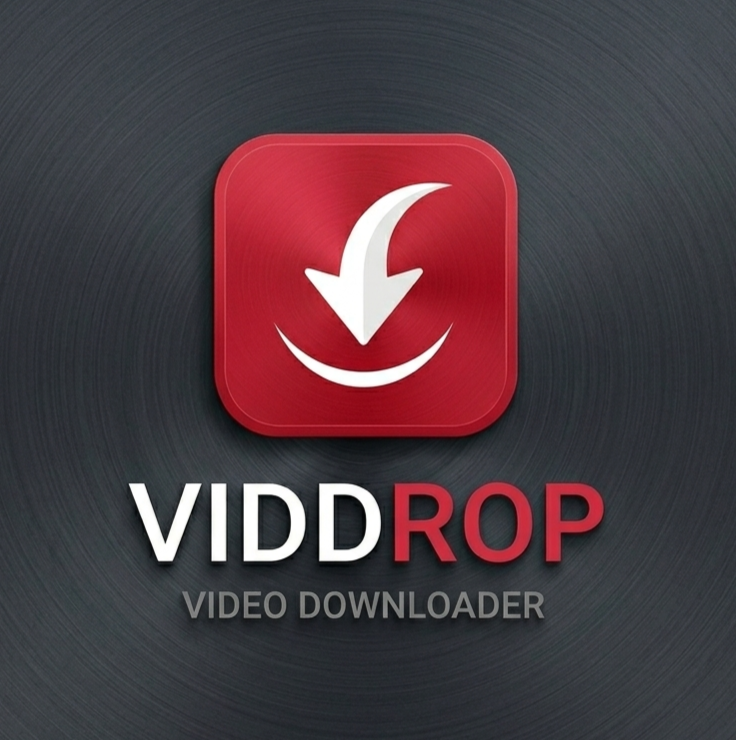

# ⚡ ViddRop Studio Pro & Web (Red Edition)

> **Téléchargeur Vidéo Haute Définition (1080p / 4K / 8K) et Convertisseur Universel pour le Montage Vidéo (Premiere Pro, Tricaster, DaVinci Resolve).**  
> Compatible YouTube, TikTok, Instagram, Facebook.



---

## 🚀 Fonctionnalités Clés

- **Qualité Maximale Réelle** : Téléchargement en résolution native (1080p, 1440p, 4K, 8K) sans bridage.
- **Profils d'Exportation Professionnels** :
  - **MP4 Universel** : Recodé en **H.264 (avc1) / AAC (mp4a)** avec **CRF 18** (qualité studio sans perte). Glisse directement sur la timeline de Premiere Pro, Tricaster et DaVinci Resolve sans conversion externe.
  - **MP3 Premium** : Extraction audio 320 kbps haute fidélité.
  - **WEBM Brut** : Flux source direct.
- **Accélération Matérielle GPU (NVIDIA NVENC)** : Recodage ultra-rapide à 300-500 FPS sur carte graphique NVIDIA GeForce.
- **Double Interface** :
  - **Application Bureau Windows** (`.exe` autonome + installeur Inno Setup).
  - **Application Web Moderne** (FastAPI + WebSocket pour le suivi de progression en temps réel).

---

## 📁 Structure du Projet

```
VIDDROP V3/
├── v5/                         # Application Bureau (Python + CustomTkinter)
│   ├── viddRop.py              # Code source principal GUI
│   ├── viddRop.spec            # Configuration PyInstaller
│   ├── installer.iss           # Script d'installation Inno Setup
│   └── viddRop.ico             # Icône de l'application
│
├── web/                        # Application Web (FastAPI + HTML5/CSS3/JS)
│   ├── server.py               # Serveur API & WebSockets
│   ├── lancer_site.bat         # Lanceur 1-clic local
│   ├── templates/index.html    # Interface utilisateur Web
│   └── static/                 # Styles CSS, Scripts JS et Assets
│
├── .gitignore                  # Exclusion des gros binaires (> 100 Mo)
└── README.md
```

---

## 🛠️ Installation & Démarrage

### 1. Prérequis
- **Python 3.10+**
- **FFmpeg & FFprobe** installés sur le système (ou placés dans le dossier du projet).

Installer les dépendances :
```bash
pip install -r requirements.txt
```
*(ou manuellement: `pip install yt-dlp customtkinter fastapi uvicorn websockets pytubefix`)*

---

### 2. Lancer la Version Web 🌐
Pour démarrer le site web localement :
```bash
cd web
python server.py
```
Ou double-cliquez simplement sur **`lancer_site.bat`**.  
Le site sera accessible dans votre navigateur à l'adresse : **`http://localhost:8000`**

---

### 3. Lancer la Version Bureau (Windows GUI) 💻
```bash
cd v5
python viddRop.py
```

Pour compiler le fichier `.exe` autonome :
```bash
cd v5
python -m PyInstaller --noconfirm viddRop.spec
```

---

## 📄 Licence
Ce projet est développé pour un usage personnel et professionnel de production vidéo.
